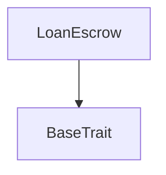
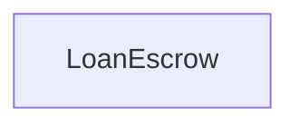

# Tact compilation report
Contract: LoanEscrow
BoC Size: 2014 bytes

## Structures (Structs and Messages)
Total structures: 24

### DataSize
TL-B: `_ cells:int257 bits:int257 refs:int257 = DataSize`
Signature: `DataSize{cells:int257,bits:int257,refs:int257}`

### SignedBundle
TL-B: `_ signature:fixed_bytes64 signedData:remainder<slice> = SignedBundle`
Signature: `SignedBundle{signature:fixed_bytes64,signedData:remainder<slice>}`

### StateInit
TL-B: `_ code:^cell data:^cell = StateInit`
Signature: `StateInit{code:^cell,data:^cell}`

### Context
TL-B: `_ bounceable:bool sender:address value:int257 raw:^slice = Context`
Signature: `Context{bounceable:bool,sender:address,value:int257,raw:^slice}`

### SendParameters
TL-B: `_ mode:int257 body:Maybe ^cell code:Maybe ^cell data:Maybe ^cell value:int257 to:address bounce:bool = SendParameters`
Signature: `SendParameters{mode:int257,body:Maybe ^cell,code:Maybe ^cell,data:Maybe ^cell,value:int257,to:address,bounce:bool}`

### MessageParameters
TL-B: `_ mode:int257 body:Maybe ^cell value:int257 to:address bounce:bool = MessageParameters`
Signature: `MessageParameters{mode:int257,body:Maybe ^cell,value:int257,to:address,bounce:bool}`

### DeployParameters
TL-B: `_ mode:int257 body:Maybe ^cell value:int257 bounce:bool init:StateInit{code:^cell,data:^cell} = DeployParameters`
Signature: `DeployParameters{mode:int257,body:Maybe ^cell,value:int257,bounce:bool,init:StateInit{code:^cell,data:^cell}}`

### StdAddress
TL-B: `_ workchain:int8 address:uint256 = StdAddress`
Signature: `StdAddress{workchain:int8,address:uint256}`

### VarAddress
TL-B: `_ workchain:int32 address:^slice = VarAddress`
Signature: `VarAddress{workchain:int32,address:^slice}`

### BasechainAddress
TL-B: `_ hash:Maybe int257 = BasechainAddress`
Signature: `BasechainAddress{hash:Maybe int257}`

### OwnershipAssigned
TL-B: `ownership_assigned#05138d91 queryId:uint64 prevOwner:address forwardPayload:remainder<slice> = OwnershipAssigned`
Signature: `OwnershipAssigned{queryId:uint64,prevOwner:address,forwardPayload:remainder<slice>}`

### NftTransfer
TL-B: `nft_transfer#5fcc3d14 queryId:uint64 newOwner:address responseDestination:address customPayload:Maybe ^cell forwardAmount:coins forwardPayload:remainder<slice> = NftTransfer`
Signature: `NftTransfer{queryId:uint64,newOwner:address,responseDestination:address,customPayload:Maybe ^cell,forwardAmount:coins,forwardPayload:remainder<slice>}`

### DeployEscrow
TL-B: `deploy_escrow#b0123410 nft:address = DeployEscrow`
Signature: `DeployEscrow{nft:address}`

### LoanRequest
TL-B: `loan_request#b0123411 nft:address borrower:address principal:coins term:uint16 exp:uint32 sig:^cell = LoanRequest`
Signature: `LoanRequest{nft:address,borrower:address,principal:coins,term:uint16,exp:uint32,sig:^cell}`

### LoanApproved
TL-B: `loan_approved#b0123412 repay:coins principal:coins dueAt:uint32 owner:address treasury:address = LoanApproved`
Signature: `LoanApproved{repay:coins,principal:coins,dueAt:uint32,owner:address,treasury:address}`

### LoanRejected
TL-B: `loan_rejected#b0123413  = LoanRejected`
Signature: `LoanRejected{}`

### RescueNft
TL-B: `rescue_nft#b0123414 nft:address to:address = RescueNft`
Signature: `RescueNft{nft:address,to:address}`

### Rescue
TL-B: `rescue#b0123415 to:address = Rescue`
Signature: `Rescue{to:address}`

### Repay
TL-B: `repay#b0123402  = Repay`
Signature: `Repay{}`

### Liquidate
TL-B: `liquidate#b0123403  = Liquidate`
Signature: `Liquidate{}`

### Withdraw
TL-B: `withdraw#b0123404 amount:coins = Withdraw`
Signature: `Withdraw{amount:coins}`

### SetMaxLoan
TL-B: `set_max_loan#b0123405 value:coins = SetMaxLoan`
Signature: `SetMaxLoan{value:coins}`

### GiftLoanPool$Data
TL-B: `_ owner:address treasury:address signerKey:uint256 maxLoan:coins = GiftLoanPool`
Signature: `GiftLoanPool{owner:address,treasury:address,signerKey:uint256,maxLoan:coins}`

### LoanEscrow$Data
TL-B: `_ pool:address nft:address status:uint8 borrower:address owner:address treasury:address principal:coins repay:coins dueAt:uint32 = LoanEscrow`
Signature: `LoanEscrow{pool:address,nft:address,status:uint8,borrower:address,owner:address,treasury:address,principal:coins,repay:coins,dueAt:uint32}`

## Get methods
Total get methods: 4

## status
No arguments

## repayAmount
No arguments

## dueAt
No arguments

## borrowerAddress
No arguments

## Exit codes
* 2: Stack underflow
* 3: Stack overflow
* 4: Integer overflow
* 5: Integer out of expected range
* 6: Invalid opcode
* 7: Type check error
* 8: Cell overflow
* 9: Cell underflow
* 10: Dictionary error
* 11: 'Unknown' error
* 12: Fatal error
* 13: Out of gas error
* 14: Virtualization error
* 32: Action list is invalid
* 33: Action list is too long
* 34: Action is invalid or not supported
* 35: Invalid source address in outbound message
* 36: Invalid destination address in outbound message
* 37: Not enough Toncoin
* 38: Not enough extra currencies
* 39: Outbound message does not fit into a cell after rewriting
* 40: Cannot process a message
* 41: Library reference is null
* 42: Library change action error
* 43: Exceeded maximum number of cells in the library or the maximum depth of the Merkle tree
* 50: Account state size exceeded limits
* 128: Null reference exception
* 129: Invalid serialization prefix
* 130: Invalid incoming message
* 131: Constraints error
* 132: Access denied
* 133: Contract stopped
* 134: Invalid argument
* 135: Code of a contract was not found
* 136: Invalid standard address
* 138: Not a basechain address
* 5815: No loan
* 11244: Not escrow
* 14430: Bad state
* 15461: Pool only
* 18536: Not due yet
* 20255: Not borrower
* 26976: Send repay + 0.15
* 34167: Loan active
* 44940: Reserve
* 57920: Owner only
* 62132: Send at least 0.15

## Trait inheritance diagram

## Contract dependency diagram

